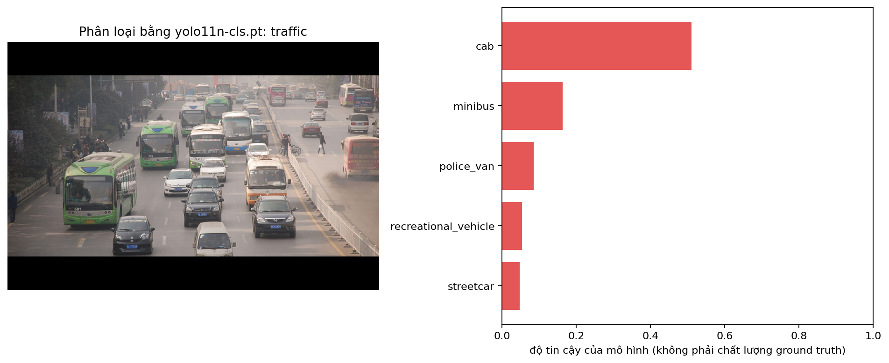
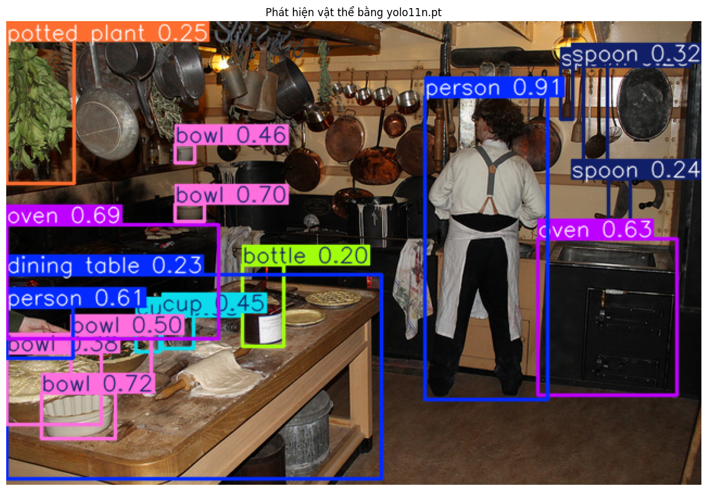
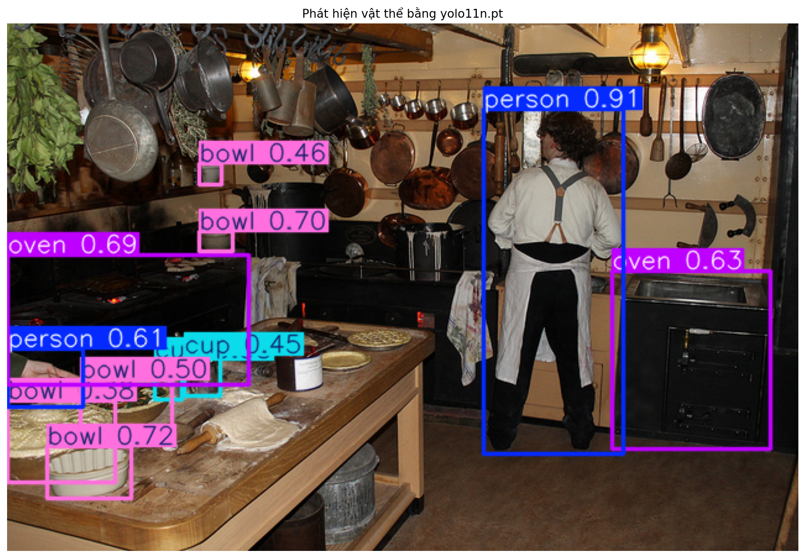
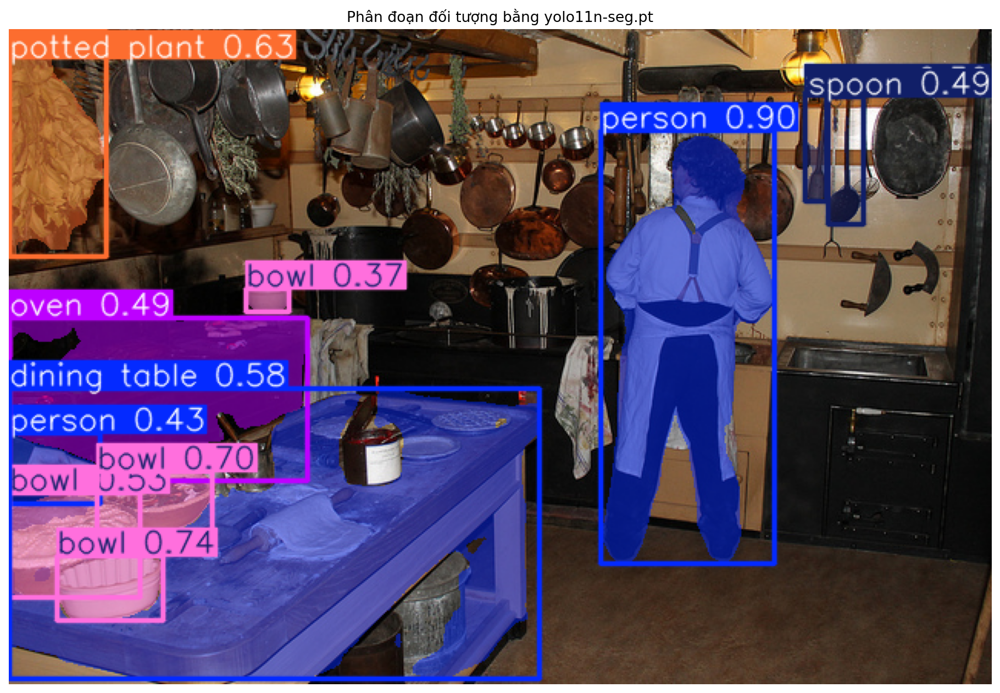

# Báo cáo bài thực hành Ngày 1 – Đọc prediction YOLO11 để hiểu định dạng nhãn

**Ngày chạy:** 11/06/2026

**Runtime Colab:** CPU/GPU

**Python / PyTorch / Ultralytics:** 

**Checkpoint:** `yolo11n-cls.pt`, `yolo11n.pt`, `yolo11n-seg.pt`

**Ngưỡng detection/segmentation dùng khi tạo JSON:** `0.35` (chỉ đổi nếu GV cho phép; nếu đổi hãy ghi rõ)

**Thay đổi so với notebook nguồn:** Không

### Từ cần nhớ (đọc nhanh trước khi viết)

| Từ | Nghĩa ngắn |
| --- | --- |
| Prediction | Kết quả model vừa đoán ra; chưa phải nhãn đúng |
| Ground truth | Nhãn do người gán theo quy tắc |
| Taxonomy | Danh sách tên lớp có sẵn kèm model (vd. ImageNet-1K, COCO-80) |
| Checkpoint | File model `.pt` đã huấn luyện sẵn |
| Guideline | Quy tắc gán nhãn do người viết |
| Annotator | Người gán nhãn |
| Reviewer / QC | Người kiểm tra nhãn |
| Escalation | Ca khó → hỏi Lab Coach, không tự bịa |
| Model score | Số “tin” của model; không phải điểm chất lượng nhãn người |

## 1. Phân loại ảnh

**Mở file:** `day1_lab_outputs/classification_predictions.json` và `visuals/classification_top5.png`.  
Chỉ dùng ảnh `sample_id = traffic`, lấy dòng `rank = 1`.

1. Chép record hạng 1:
```
  {
    "sample_id": "traffic",
    "coco_image_id": 210273,
    "image_width": 640,
    "image_height": 428,
    "task": "image_classification",
    "taxonomy_name": "ImageNet-1K",
    "model_file": "yolo11n-cls.pt",
    "model_sha256": "c62d41bf9625777760018bf914d2e6cd472420ccd01706d97a61cb6c82502bd7",
    "ultralytics_version": "8.4.145",
    "rank": 1,
    "class_id": 468,
    "class_name": "cab",
    "score": 0.510915
  }
```

2. Record này nói về **cả bức ảnh** hay về **một vật thể riêng** trong ảnh? Vì sao bạn nghĩ vậy?

    Record này nói về cả bức ảnh. Quy định bài toán phân loại cấp độ toàn ảnh (image-level), chỉ gán nhãn tổng quát cho cả khung hình.

3. Danh sách tên lớp (class list) do đâu mà có: model tự nghĩ ra, hay đi kèm taxonomy/checkpoint?

    Đi kèm taxonomy/checkpoint: danh sách 1.000 lớp cố định thuộc bộ taxonomy ImageNet-1K có sẵn bên trong file checkpoint yolo11n-cls.pt

4. Vì sao cần ghi cả `class_id`, `class_name` và `taxonomy_name`, không chỉ ghi mỗi tên lớp?

    `class_id` và `class_name`: Có thể hiểu là mã định danh đi kèm với short description giúp con người đọc hiểu và kiểm tra nhanh mà không cần tra cứu phức tạp

    `taxonomy_name`: Đảm bảo tính nhất quán và truy xuất nguồn gốc dữ liệu, ví dụ cùng `class_id` hoặc `class_name` ở các bộ taxonomy khác nhau có thể có ánh xạ tới đối tượng và định nghĩa khác nhau

5. Nếu trong ảnh có nhiều vật / nhiều chủ đề, guideline cần nói rõ điều gì để người gán nhãn chọn **một** lớp?

    Xác định chủ thể chính: tiêu chí chọn đối tượng trọng tâm của ảnh - ví dụ đối tượng trọng tâm là tiền cảnh, hoặc trung tâm của hành động/bối cảnh xuất hiện trong ảnh

    Thứ tự ưu tiên khi có chủ thể ngang bằng nhau: ví dụ ưu tiên đối tượng mục tiêu của bài toán thay vì các đối tượng nền

    Xác định ngưỡng tối thiểu để label, các csse mơ hồ/phức tạp cần đưa vào quy trình escalation

6. Vì sao không được lấy `score` của model làm ground truth?

    Bản chất `score` chỉ là confidence của một checkpoint cụ thể tại thời điểm, không phải label đã được xác thực

    `score` cao không đồng nghĩa với label đó là đúng, việc lấy `score` làm ground truth có thể dẫn tới việc mô hình sẽ học trên những lỗi sai đó và làm khuếch đại nó lên

## 2. Phát hiện vật thể

**Mở file:** `day1_lab_outputs/detection_predictions.json` và `visuals/detection_predictions.png`.  
Chỉ dùng ảnh `sample_id = kitchen`. Chọn **một** record.  
Số lượng prediction theo ngưỡng: xem output ô so sánh `0.20` / `0.35` / `0.60` trong notebook.

1. Chép một record: 

```
  {
    "sample_id": "kitchen",
    "coco_image_id": 397133,
    "image_width": 640,
    "image_height": 427,
    "task": "object_detection",
    "taxonomy_name": "COCO-80",
    "model_file": "yolo11n.pt",
    "model_sha256": "0ebbc80d4a7680d14987a577cd21342b65ecfd94632bd9a8da63ae6417644ee1",
    "ultralytics_version": "8.4.145",
    "score_threshold": 0.35,
    "class_id": 69,
    "class_name": "oven",
    "score": 0.6343,
    "coordinate_unit": "pixel",
    "bbox_format": "xyxy",
    "bbox_xyxy": [
      489.09,
      200.73,
      617.81,
      344.88
    ],
    "bbox_width": 128.72,
    "bbox_height": 144.15
  }
```

2. Giải thích box bằng lời thường: góc trên-trái ở đâu, góc dưới-phải ở đâu, rộng/cao bao nhiêu pixel?

    Góc trên trái ở (x,y) = (489.09, 200.73)
    Góc dưới phải ở (x,y) = (617.81, 334.88)
    H = 128.72px, W = 134.15px

3. Chọn hai ngưỡng (vd. 0.20 và 0.60). Mỗi ngưỡng có bao nhiêu prediction?

    0.35 có 11 prediction trên ảnh mẫu kitchen
    0.2  có 17 prediction trên ảnh mẫu kitchen

4. Khi hạ ngưỡng (giữ nhiều hộp hơn), người **reviewer** phải làm thêm việc gì?

    Threshold = 0.20
    
    Threshold = 0.35
    

    Lọc các trường hợp gán nhầm lớp: rà soát những trường hợp có confidence thấp, ví dụ như trong ảnh predicted với threshold 0.2, potted plant 0.25 ở góc trên bên trái hoặc bottle 0.2 đang bị gán nhãn sai

    Loại bỏ những box bị trùng lặp hoặc false positive (không tồn tại object nhưng vẫn có box)

    Chỉnh lại độ lớn hoặc quyết định giữ hay bỏ box của những vật thể mờ, bị che khuất, ... theo guideline

5. Viết **một quy tắc box** để người gán nhãn làm theo (áp dụng được cho nhiều ảnh, không chỉ ảnh này).

    Ôm sát phần hiển thị & tách riêng từng cá thể:
    Vẽ bounding box ôm sát nhất có thể vào phần nhìn thấy được của từng vật thể thuộc danh sách taxonomy; không để khoảng trống thừa quanh vật thể và không tự suy đoán/kéo dài hộp sang phần bị vật khác che khuất hoàn toàn. Nếu nhiều vật thể cùng lớp nằm sát nhau hoặc chồng lấp (ví dụ nhiều chiếc bát xếp cạnh nhau, hai người đứng gần nhau), phải tách thành từng box riêng biệt cho mỗi cá thể.

6. Trên ảnh `kitchen`, chỉ ra **một** vật bị che khuất hoặc cắt mép. Bạn sẽ viết thành quy tắc trong guideline, hay đưa lên hỏi Lab Coach (escalation)? Vì sao?

    Ví dụ box `person 0.61` hình ảnh cho thấy chỉ có một bàn tay của một người.

    Viết thành quy tắc trong guideline: vì đây là tình trạng phổ biến thường gặp trong các ds thực tế, nếu như hầu hết case đưa thành `escalated` có thể gây chậm trễ tiến độ tổng thể. Tất nhiên cần thống nhất quy ước chung cho mọi ảnh giúp annotator và reviewer làm việc.

    Chỉ thực hiện escalation khi gặp ca ngoại lệ gây mơ hồ về định nghĩa taxonomy mà guideline chưa quy định (ví dụ: phần bị cắt mép chỉ còn lộ một góc quá nhỏ không rõ là bowl hay cup, hoặc quầy bếp bị cắt mép có được tính là dining table hay không).


## 3. Phân đoạn theo từng đối tượng

**Mở file:** `day1_lab_outputs/segmentation_predictions.json` và `visuals/segmentation_prediction.png`.  
Chỉ dùng ảnh `sample_id = kitchen`. Chọn **một** record.

1. Chép một record: `instance_id`=… ; `class_name`=… ; `score`=… ; số điểm polygon=`polygon_point_count`=… ; 3–5 điểm đầu của `polygon_xy`=…

    ```
    {
        "sample_id": "kitchen",
        "coco_image_id": 397133,
        "image_width": 640,
        "image_height": 427,
        "task": "instance_segmentation",
        "taxonomy_name": "COCO-80",
        "model_file": "yolo11n-seg.pt",
        "model_sha256": "55ed65c56c91713d23e8402371c6c49a6fd84f257f7dce452e8d70e41dcbe152",
        "ultralytics_version": "8.4.145",
        "score_threshold": 0.35,
        "instance_id": "kitchen-006",
        "class_id": 45,
        "class_name": "bowl",
        "score": 0.528202,
        "coordinate_unit": "pixel",
        "bbox_format": "xyxy",
        "bbox_xyxy": [
        0.11,
        302.85,
        85.7,
        370.15
        ],
        "polygon_point_count": 84,
        "polygon_xy": [
        [
            29.0,
            303.0
        ],
        [
            28.0,
            304.0
        ],
        [
            26.0,
            304.0
        ],
        [
            25.0,
            305.0
        ],
        [
            23.0,
            305.0
        ],
        ...
        ]
    }
    ```
    
2. So với box, polygon cho thêm thông tin gì về hình dạng vật thể?

    Cho biết thêm đường bao thực tế, khác với bbox - bị dư nhiều vùng backgound của object, polygon cho biết hình dạng thực tế của object, lồi lõm hoặc có hình dạng phức tạp. Và cũng vì lý do đó, polygon ít bị nhiễu từ backgound hơn bbox.

3. `instance_id` dùng để làm gì? Nó **không** phải class ID và **không** phải tracking ID — bạn hiểu câu này thế nào?

    `instance_id` dùng để định danh duy nhất cho từng instance trong toàn bộ khung hình, từ đó phân biệt được các object chung một class.

    Không phải class ID: class ID có thể dùng chung cho nhiều object, `instance_id` thì không 

    Không phải tracking ID: vì đây là ảnh tĩnh

4. Viết **một quy tắc vẽ biên mask** để người gán nhãn làm theo.

    Đặt các đỉnh của polygon bám sát ranh giới pixel thực tế của phần vật thể nhìn thấy được; tăng mật độ điểm ở các đoạn cong hoặc chi tiết gấp khúc (như quai cốc, ngón tay, miệng bát) và giảm điểm ở các cạnh thẳng để không cắt vào vật thể hay tràn ra bg. Không vẽ gộp một mask chung cho nhiều vật thể chạm nhau hoặc cùng loại — mỗi cá thể phải là một polygon khép kín độc lập.

5. Trên ảnh `kitchen`, chỉ ra **một** chỗ biên mờ / hai vật chạm nhau / bị che. Bạn dùng guideline hay escalation? Vì sao?

    Ví dụ `bowl 0.38` và `bowl 0.72`
    dùng guideline, lý do tương tự như phần 1 classification

## 4. Vòng đời và kiểm tra chất lượng

Lab hôm nay chỉ **xem prediction**. Chuỗi dưới đây là vòng đời production để bạn nối các khái niệm:

`ảnh thô → guideline → ground truth → huấn luyện → prediction → QC/rework`

Điền bảng (viết ngắn, có dẫn chứng từ JSON/PNG khi nói về lỗi):

| Tác vụ | Ground truth trông như thế nào? (đơn vị nhãn) | Lỗi hoặc chỗ khó quyết định bạn thấy trên ảnh/JSON | Annotator làm gì? | Reviewer xem gì? |
| --- | --- | --- | --- | --- |
| Phân loại ảnh | **1 nhãn lớp duy nhất** (`class_id` / `class_name`) đại diện cho **toàn bộ bức ảnh**, chọn từ bộ taxonomy cố định (vd. ImageNet-1K). | Trong `classification_predictions.json` (sample `traffic`), ảnh có nhiều xe buýt, ô tô và người đi bộ nhưng mô hình chỉ gán 1 nhãn cục bộ là `cab` (`rank=1`, `score=0.510915`), sau đó là `minibus` (`0.164284`) do taxonomy không có nhãn cảnh giao thông chung. | Quan sát toàn bộ ảnh, đối chiếu quy tắc ưu tiên trong guideline để chọn 1 lớp chính xác nhất; gặp cảnh đa chủ thể không rõ lớp chính thì gửi escalation. | Kiểm tra nhãn được chọn có khớp chủ thể chính theo guideline không, không tự ý gán nhãn nằm ngoài danh sách taxonomy. |
| Phát hiện vật thể | Tập hợp các **bounding box hình chữ nhật** (`bbox_xyxy` theo pixel) kèm **1 nhãn lớp** cho từng vật thể thuộc taxonomy (COCO-80). | Trên sampble `kitchen` các vật thể nhỏ như `spoon`, `bottle`, `potted plant` (chỉ xuất hiện ở threshold `conf=0.20`, 17 vật thể); các object xếp sát nhau khó tách ranh giới box. | Kéo box ôm sát rìa ngoài cùng của từng vật thể thuộc taxonomy (kể cả vật thể nhỏ hoặc bị che khuất một phần theo quy định), gán đúng lớp và không gộp chung nhiều vật thể vào 1 box. | Kiểm tra độ khít của box (không lấy dư vào vật thể khác hay bg), rà soát lỗi bỏ sót vật thể nhỏ (false negative), lỗi vẽ trùng box hoặc gán nhầm lớp. |
| Instance segmentation | Tập hợp các **đa giác kín (polygon)** gồm chuỗi điểm `[x, y]` bám sát đường biên từng cá thể vật thể, kèm **nhãn lớp** và định danh cá thể riêng (tách biệt từng object cùng lớp). | Ở cùng ngưỡng `0.35`, `segmentation_predictions.json` sample `kitchen` nhiều object chồng chéo lên nhau có thể dẫn tới trường hợp bị gộp chung thành 1 instance hoặc tách nhầm thành 2 instance riêng biệt  | Chấm các đỉnh polygon bám sát đường viền thực tế của từng cá thể; tách riêng từng instance cùng lớp (từng chiếc `bowl` độc lập) và khoanh đúng phần nhìn thấy khi vật thể bị che khuất theo guideline. | Soi độ chính xác của đường biên polygon (không lem ra bg hay cắt vào vật thể), kiểm tra việc tách đúng từng cá thể riêng lẻ đảm bảo đa giác không bị vỡ thành nhiều mảnh rời rạc. |

## 5. An toàn dữ liệu

1. **Quy tắc bảo vệ dữ liệu của bạn cho bài lab này là gì? (viết 1 câu)**

   Chỉ sử dụng ba ảnh COCO công khai có sẵn trong bài lab, tuyệt đối không tải lên ảnh cá nhân, dữ liệu nội bộ hay đưa thông tin nhận diện cá nhân vào báo cáo/các tệp output

2. **Nếu gặp ảnh hoặc dữ liệu không đúng phạm vi, bạn sẽ dừng và báo cho ai?**

   Dừng thao tác ngay lập tức (không tự ý xử lý hay gán nhãn) và thực hiện escalation để báo cho **Lab Coach** (hoặc mentor / giảng viên hướng dẫn)

## 6. Checklist trước khi nộp link repo

Kiểm tra trên GitHub trong thư mục `report/`:

- [x] `REPORT.md` (file này đã điền)
- [x] `day1_lab_outputs/classification_predictions.json`
- [x] `day1_lab_outputs/detection_predictions.json`
- [x] `day1_lab_outputs/segmentation_predictions.json`
- [x] `day1_lab_outputs/IMAGE_ATTRIBUTION.md`
- [x] `day1_lab_outputs/visuals/classification_top5.png`
- [x] `day1_lab_outputs/visuals/detection_predictions.png`
- [x] `day1_lab_outputs/visuals/segmentation_prediction.png`
- [x] Ô validation cuối notebook báo `PASS`
- [x] Không có họ tên, MSSV hoặc dữ liệu nhạy cảm trong báo cáo/output
- [ ] Đã nộp **link repository** trên LMS
